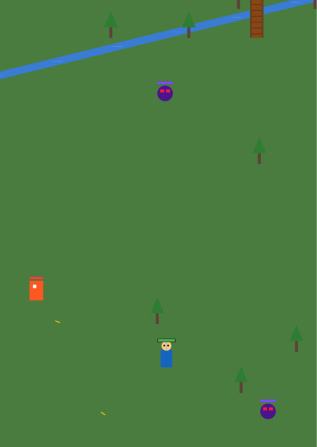
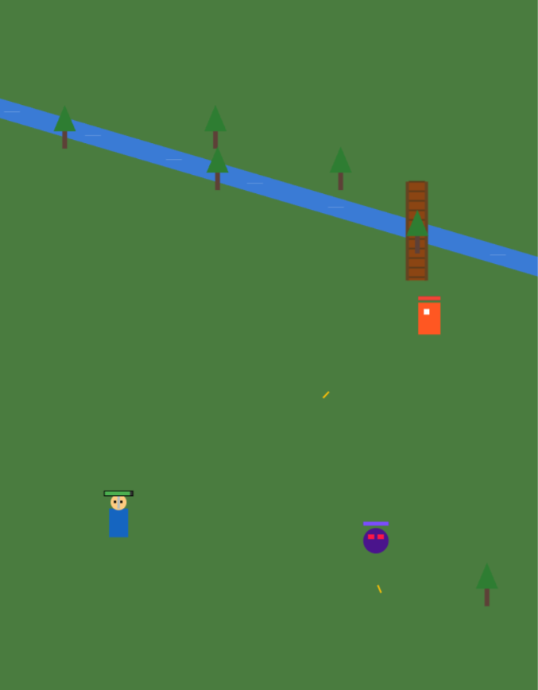

# The River of Life: An RPG Tale

A single-file HTML5 canvas roguelike. Walk north through a mountain valley, cross meandering rivers, fight arrow-shooters and chasing walkers, and defeat a 3-phase boss.

## Live Demo

[▶ Play in your browser](https://enfren.github.io/river-of-life/)

## Screenshots

| Valley | River Crossing |
|---|---|
|  |  |

## Features

- **Vertical scrolling** — avatar anchored at 25% from bottom for reaction time
- **3 river crossings** — left→right, right→left, left→right (each narrower)
- **Vertical bridges** — cross the river at 5 checkpoints
- **2 enemy types** — orange shooters (patrol + aim) and purple walkers (chase + contact damage)
- **3-phase boss** — red → purple → orange, with arrow spreads and boulder slams
- **Self-healing** — 1 HP / 2 s, resets on hit
- **Item drops** — potions (heal 3) and coins (score)
- **Checkpoint save** — auto-saves at each bridge via `localStorage`
- **Sound** — Web Audio API oscillators, no audio files
- **Fullscreen responsive** — adapts to any monitor size or orientation

## Controls

| Key | Action |
|---|---|
| ↑ / W | Walk north (forward) |
| ↓ / S | Walk south |
| ← → / A D | Strafe |
| Space | Shoot |
| R | Resume from checkpoint |

## Tech

- Pure vanilla JS + Canvas 2D — no libraries, no build step
- Single `index.html` file
- Web Audio API for SFX
- `localStorage` for checkpoint saves

## Roadmap

- [ ] Port to C++ / SDL2
- [ ] Sprite art (replace canvas primitives)
- [ ] Multiple levels / procedurally generated maps
- [ ] Inventory system (spend coins on upgrades)
- [ ] Mobile touch controls

